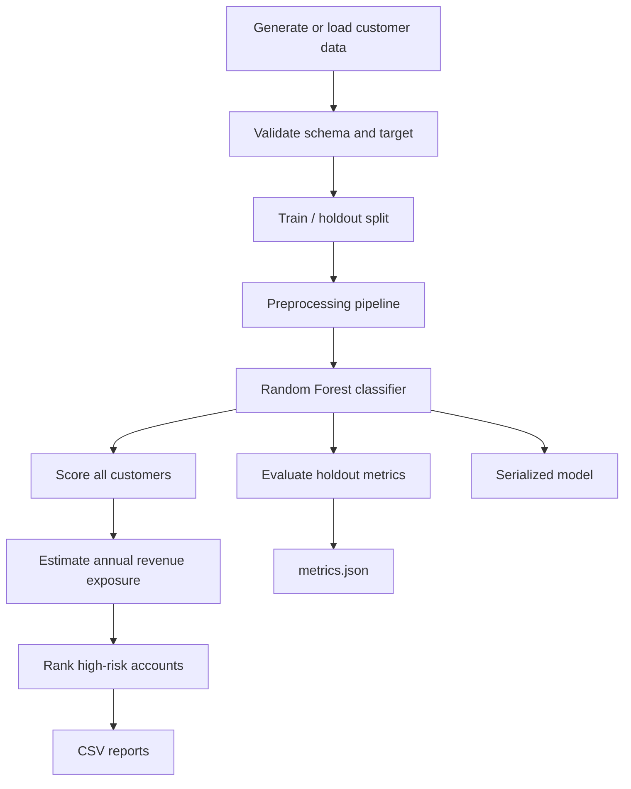

# Customer Churn Prediction & Revenue-Risk Analytics

<p align="center">
  <strong>A reproducible machine-learning workflow for customer churn intelligence and revenue-risk prioritization.</strong>
</p>

<p align="center">
  <a href="https://github.com/pallasivasai/rick/actions/workflows/ci.yml"></a>
  
  
  
  
  
</p>

> **Data integrity:** The default generator creates synthetic demonstration data. Metrics from synthetic data are useful for testing the workflow, but they are not evidence of real-world business performance. Validate on representative, time-aware production data before using predictions operationally.

## Project overview

This project trains a Random Forest classifier to estimate churn probability, converts that probability into an annual revenue-exposure estimate, and ranks customers for human-reviewed retention outreach.

## Repository statistics

| Project statistic | Current configuration |
| --- | ---: |
| Default synthetic dataset size | 5,000 customer records |
| Input predictors | 7 features |
| Dataset fields | 9 columns, including customer ID and target |
| Training / holdout split | 80% / 20% |
| Classifier | Random Forest |
| Number of trees | 300 |
| Default high-risk threshold | 0.65 (65%) |
| Automated test cases | 5 |
| Supported Python versions in CI | 3.10, 3.11, 3.12 |

### Live repository statistics

The badges at the top display live GitHub repository stars, forks, and last commit. GitHub Actions status is also linked to the default branch's CI workflow.

### Model evaluation statistics

The pipeline calculates these metrics from the current holdout dataset and writes the measured values to `artifacts/metrics.json` after each run:

| Metric | Meaning |
| --- | --- |
| ROC-AUC | Ranking/separation quality across classification thresholds |
| Accuracy | Fraction of holdout predictions classified correctly at the configured threshold |
| Precision | Fraction of predicted churners that are actual churners |
| Recall | Fraction of actual churners detected |
| Confusion matrix | True/false positives and negatives |
| Churn rate | Churn share in the generated or supplied dataset |

**No fixed model-performance score is advertised here.** Run the pipeline on your data and use the generated metrics file for the actual measured results.

## Key capabilities

- Deterministic synthetic dataset generation with a configurable seed.
- Preprocessing and Random Forest training in one scikit-learn pipeline.
- Stratified holdout evaluation with ROC-AUC, precision, recall, accuracy, and confusion matrix.
- Customer scoring with Low / Medium / High risk levels.
- Estimated annual revenue exposure and prioritized retention suggestions.
- Exported model, metrics, full scores, and high-risk customer list.
- Automated tests and GitHub Actions CI across Python 3.10–3.12.

## Architecture



## Project structure

```text
rick/
├── .github/workflows/ci.yml
├── tests/test_pipeline.py
├── .gitignore
├── churn_model.py
├── generate_data.py
├── requirements.txt
└── README.md
```

## Quick start

Python 3.10 or newer is recommended.

```bash
python -m venv .venv

# Windows PowerShell
.venv\Scripts\Activate.ps1

# macOS / Linux
source .venv/bin/activate

python -m pip install -r requirements.txt
python generate_data.py
python churn_model.py
```

Customize the dataset, output directory, or decision threshold:

```bash
python generate_data.py --samples 8000 --seed 21 --output data/customers.csv
python churn_model.py --data data/customers.csv --output-dir outputs/run-01 --threshold 0.60
```

## Generated artifacts

| Artifact | Description |
| --- | --- |
| `churn_model.joblib` | Trained preprocessing and classifier pipeline with feature and threshold metadata |
| `metrics.json` | Holdout ROC-AUC, accuracy, precision, recall, confusion matrix, and class report |
| `customer_churn_scores.csv` | All customers ranked by estimated annual revenue exposure |
| `high_risk_customers.csv` | Customers at or above the configured probability threshold |

## Model methodology

Categorical values are one-hot encoded with unknown-category support. Numeric fields are median-imputed and standardized. Preprocessing is fitted only on the training split by keeping transformations and the classifier in a single pipeline.

The project uses a stratified 80/20 train/test split and a fixed random seed for reproducibility. The default risk threshold is 0.65. Tune the threshold using validation data, intervention capacity, and the relative cost of false positives and false negatives; it is not a universal business setting.

### Revenue exposure estimate

`annual_revenue_at_risk_inr = monthly_charges_inr × 12 × churn_probability`

This represents expected exposure, not guaranteed revenue loss or retained revenue. It does not model gross margin, contract duration, probability of successful intervention, or recovery outcomes.

### Retention recommendations

Illustrative recommendations are based on payment history, monthly charges, and contract type. They are decision-support suggestions only; require human review before customer outreach or incentives.

## Data dictionary

| Feature | Meaning |
| --- | --- |
| `customer_id` | Synthetic customer identifier |
| `tenure_months` | Customer tenure in months |
| `contract_type` | Month-to-Month, Annual, or Two-Year |
| `monthly_charges_inr` | Monthly subscription amount in INR |
| `login_days_last_30` | Days active in the last 30 days |
| `usage_drop_pct` | Simulated usage decline percentage |
| `support_tickets` | Support tickets recorded |
| `late_payments` | Number of late payments |
| `churn` | Target label: 1 = churn, 0 = retained |

## Tests and continuous integration

```bash
python -m pip install pytest
pytest -q
```

GitHub Actions runs tests and a command-line smoke test on Python 3.10, 3.11, and 3.12 for pushes and pull requests.

## Responsible use and production checklist

- Never present synthetic-data performance as a real customer result.
- Evaluate with representative, time-aware data and monitor data drift.
- Check probability calibration, subgroup performance, and error costs.
- Protect customer information; do not commit personally identifiable data.
- Keep retention decisions explainable and subject to human review.

## License

No license is currently specified. Add a license before granting reuse or redistribution permissions.
