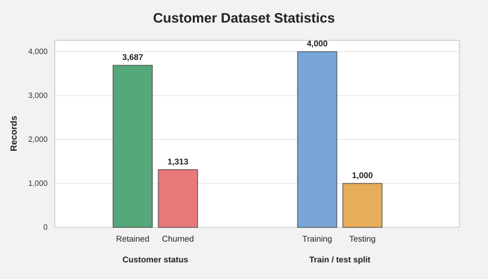
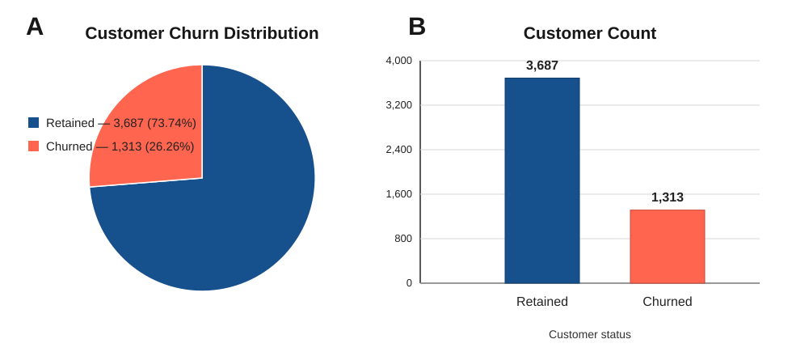
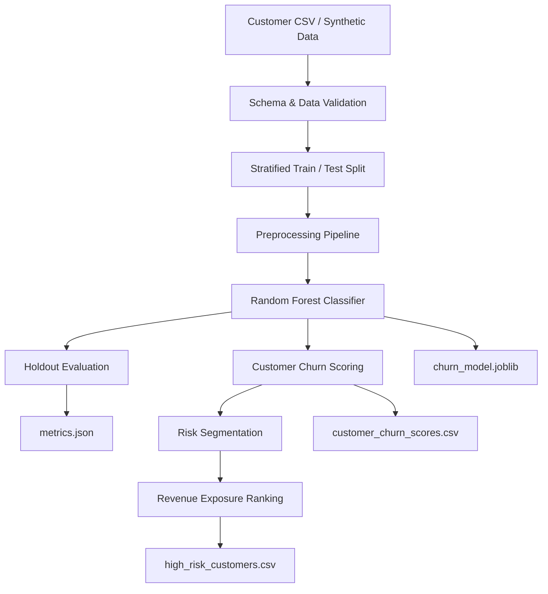

<div align="center">

# Customer Churn Prediction & Revenue-Risk Analytics

**An end-to-end machine-learning workflow to predict customer churn, quantify revenue exposure, and prioritize retention actions.**

[](https://github.com/pallasivasai/rick/actions/workflows/ci.yml)


[Overview](#project-overview) • [Statistics](#project--dataset-statistics) • [Pie Chart](#customer-churn-pie-chart) • [Architecture](#system-architecture) • [Quick Start](#quick-start) • [Metrics](#model-evaluation)

</div>

---

## Project overview

Customer churn directly affects recurring revenue. This project builds a reproducible classification pipeline that estimates the probability of a customer leaving, translates that probability into an estimated annual revenue exposure, and produces a ranked list to support retention teams.

**The workflow:** Generate or load customer data → validate → preprocess → train → evaluate → score customers → estimate revenue exposure → export reports.

> [!IMPORTANT]
> The included dataset is **synthetic demonstration data** generated by this repository. Its churn distribution and model scores are not real-world business results. Validate the model with representative, time-aware customer data before operational use.

## Project & dataset statistics

<div align="center">

| Dataset / project indicator | Value |
|:---|---:|
| Default synthetic customer records | **5,000** |
| Input predictors | **7** |
| Total dataset columns | **9** |
| Training data | **4,000 (80%)** |
| Holdout test data | **1,000 (20%)** |
| Churn target classes | **2 (Yes / No)** |
| Contract categories | **3** |
| Random Forest estimators | **300 trees** |
| Default classification threshold | **0.65 (65%)** |
| Automated test cases | **5** |
| Python versions in CI | **3.10 · 3.11 · 3.12** |

</div>

### Visual statistics

The chart compares customer status and the training/test split. Values are record counts from the default synthetic dataset.

<div align="center">
  
</div>

### Dataset feature overview

| Feature | Data type | Description |
|:---|:---|:---|
| `customer_id` | Identifier | Synthetic customer reference |
| `tenure_months` | Numeric | Customer tenure in months |
| `contract_type` | Categorical | Month-to-Month, Annual, Two-Year |
| `monthly_charges_inr` | Numeric | Monthly subscription charges (INR) |
| `login_days_last_30` | Numeric | Active days in the last 30 days |
| `usage_drop_pct` | Numeric | Simulated usage decline |
| `support_tickets` | Numeric | Number of support tickets |
| `late_payments` | Numeric | Recorded late-payment count |
| `churn` | Binary target | 1 = churn, 0 = retained |

## Interactive charts

The charts embedded in this README are static previews because GitHub does not run custom JavaScript or hover interactions inside README images. To explore the same customer statistics interactively, use the separate dashboard:

**[Open the interactive customer churn dashboard](https://pallasivasai.github.io/rick/)**

In the dashboard, move your mouse over a pie slice or bar to highlight it and display its customer count and percentage. Keyboard users can focus chart elements to view the same details.

**One-time publishing setup:** Open [Repository Settings → Pages](https://github.com/pallasivasai/rick/settings/pages). Under **Build and deployment**, set **Source** to **GitHub Actions**. The workflow at `.github/workflows/pages.yml` will publish the dashboard. Once its Actions run succeeds, the dashboard link above will open the live interactive page.

## Customer churn pie chart

The chart below presents the same synthetic dataset in two views: **A**, a pie chart showing the share of each customer class; and **B**, a bar chart showing the exact record counts. The default generator uses 5,000 rows and seed 42. These are synthetic demonstration values, not real-world customer results.

<div align="center">
  
</div>

| Customer class | Records | Share |
|:---|---:|---:|
| Retained | 3,687 | 73.74% |
| Churned | 1,313 | 26.26% |
| **Total** | **5,000** | **100%** |

To reproduce the dataset and its summary:

```bash
python generate_data.py --samples 5000 --seed 42
```

## Key features

- **Reproducible data generation** — configurable sample size and random seed.
- **Input validation** — checks required columns, target values, and empty datasets.
- **Leakage-aware preprocessing** — imputers, scaling, and one-hot encoding are fitted inside the training pipeline.
- **Random Forest classifier** — 300 estimators, balanced class weights, and a fixed random state.
- **Model evaluation** — ROC-AUC, accuracy, precision, recall, confusion matrix, and classification report.
- **Customer risk segmentation** — Low, Medium, and High risk categories.
- **Revenue exposure estimation** — ranks customers using estimated annual revenue at risk.
- **Retention decision support** — assigns illustrative retention tracks and recommended actions.
- **Exportable outputs** — serialized model, JSON metrics, complete customer scores, and high-risk customer CSV.
- **Automated quality checks** — pytest and GitHub Actions for Python 3.10–3.12.

## Model evaluation

The model is evaluated on a stratified holdout set. The actual values are calculated every time the pipeline runs and saved to `artifacts/metrics.json`.

| Metric | What it tells you |
|:---|:---|
| ROC-AUC | How well the model ranks churners above non-churners |
| Accuracy | Overall share of correct predictions at the selected threshold |
| Precision | How many predicted churners actually churned |
| Recall | How many actual churners the model detected |
| Confusion matrix | True positives, true negatives, false positives, false negatives |
| Churn rate | Share of churn labels in the supplied dataset |

**No unverified accuracy or ROC-AUC score is claimed in this README.** Run the model to see measured results for your dataset.

## Revenue-risk calculation

```text
Annual Revenue at Risk = Monthly Charges × 12 × Churn Probability
```

This is an estimate of expected revenue exposure. It is not guaranteed revenue loss, and it does not account for profit margin, contract duration, intervention success, or recovery outcomes.

## System architecture



## Technology stack

| Area | Technologies |
|:---|:---|
| Language | Python 3.10+ |
| Data processing | Pandas, NumPy |
| Machine learning | scikit-learn |
| Model persistence | Joblib |
| Data export | CSV, JSON |
| Testing | pytest |
| CI/CD | GitHub Actions |

## Project structure

```text
rick/
├── .github/
│   └── workflows/
│       ├── ci.yml
│       └── pages.yml
├── assets/
│   ├── customer-dataset-statistics.svg
│   └── customer-churn-pie-and-bar.svg
├── docs/
│   └── index.html
├── tests/
│   └── test_pipeline.py
├── .gitignore
├── churn_model.py
├── generate_data.py
├── requirements.txt
└── README.md
```

## Quick start

### 1. Clone the repository

```bash
git clone https://github.com/pallasivasai/rick.git
cd rick
```

### 2. Create and activate a virtual environment

```bash
python -m venv .venv

# Windows PowerShell
.venv\Scripts\Activate.ps1

# macOS / Linux
source .venv/bin/activate
```

### 3. Install dependencies

```bash
python -m pip install --upgrade pip
python -m pip install -r requirements.txt
```

### 4. Generate synthetic data

```bash
python generate_data.py
```

### 5. Train, evaluate, and score

```bash
python churn_model.py
```

### Custom run

```bash
python generate_data.py --samples 8000 --seed 21 --output data/customers.csv
python churn_model.py --data data/customers.csv --output-dir outputs/run-01 --threshold 0.60
```

## Generated artifacts

| File | Purpose |
|:---|:---|
| `churn_model.joblib` | Trained preprocessing + classifier pipeline and metadata |
| `metrics.json` | Holdout metrics and classification report |
| `customer_churn_scores.csv` | All customers with churn probabilities and risk details |
| `high_risk_customers.csv` | Customers meeting the configured risk threshold |

## Tests & continuous integration

Run tests locally:

```bash
python -m pip install pytest
pytest -q
```

GitHub Actions runs the test suite and CLI smoke test against Python **3.10, 3.11, and 3.12** on pushes to the default branch and on pull requests.

[](https://github.com/pallasivasai/rick/actions/workflows/ci.yml)

## Responsible use

- Treat synthetic-data metrics as demonstrations only.
- Validate with representative and time-aware production datasets.
- Review calibration, subgroup performance, and false-positive / false-negative costs.
- Protect customer information and never commit personally identifiable data.
- Keep retention recommendations explainable and subject to human review.

## License

No license is currently specified. Add a license before granting reuse or redistribution permissions.

---

<div align="center">

**Built with Python and machine learning**

[Repository](https://github.com/pallasivasai/rick) · [Issues](https://github.com/pallasivasai/rick/issues) · [GitHub Actions](https://github.com/pallasivasai/rick/actions)

</div>
